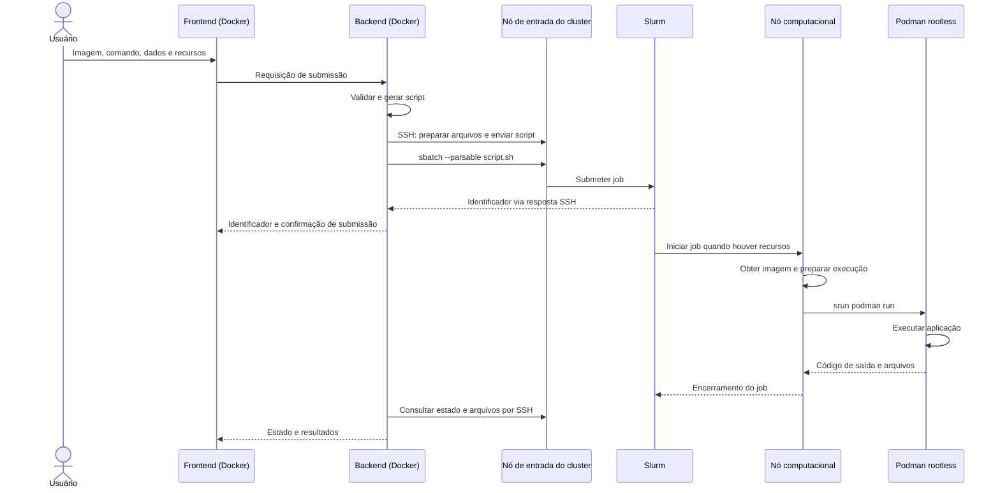

# OpenBatch: submissão e execução de jobs com Podman

> Atualização após os testes WSL: a implementação está em `openbatch/podman-jobs.js`,
> com interface em `ContainerJobs.jsx` e implantação em `openbatch/compose.yaml`.
> No laboratório com Podman 5.7, `cgroupfs` e `cgroupns=host` sozinhos deixaram o
> contêiner fora da hierarquia do job. O comando implementado usa
> `--cgroups=disabled`, sem `--cgroupns` na linha de comando, para herdar o cgroup
> criado pelo Slurm. Foram observados OOM no cgroup e encerramento por cancelamento;
> o estado Podman pode ficar desatualizado após SIGKILL e precisa de reconciliação.
> Consulte `openbatch/README.md` para o fluxo implementado e as limitações atuais.

## Objetivo e escopo

A evolução do OpenBatch combina duas frentes: implantação do frontend e do backend em contêineres Docker, coordenados pelo Docker Compose, e execução dos jobs dos usuários em contêineres com Podman rootless nos nós computacionais alocados pelo Slurm.

Este documento registra a concepção do fluxo e orienta sua implementação e validação. A implementação inicial e os testes integrados no laboratório WSL estão descritos na atualização acima e no README da aplicação; recursos distribuídos ainda exigem configuração adicional.

O backend gera scripts de submissão, comunica-se com o nó de entrada do cluster por SSH e utiliza `sbatch`. O Slurm gerencia filas, alocação, execução, acompanhamento e cancelamento. Podman inicia o ambiente de software da aplicação dentro da alocação concedida.

## Arquitetura



| Componente | Responsabilidade |
|---|---|
| Frontend | Receber parâmetros e apresentar estado, erros e resultados. |
| Backend | Validar dados, gerar script, realizar operações SSH e correlacionar a solicitação com o job. |
| Nó de entrada | Disponibilizar comandos Slurm e acesso aos diretórios de submissão. |
| Slurm | Escalonar, alocar recursos e controlar o ciclo de vida do job. |
| Nó computacional | Disponibilizar Podman e executar o script sob a identidade do usuário. |
| Podman | Obter imagens e executar o contêiner rootless. |
| Armazenamento | Disponibilizar entradas e preservar resultados acessíveis após a execução. |

## Fluxo de funcionamento

### 1. Recebimento dos parâmetros

O usuário informa nome do job, partição autorizada, CPUs, memória, tempo máximo, referência da imagem, executável e argumentos. Também seleciona os arquivos de entrada e o destino dos resultados conforme os diretórios permitidos pela plataforma.

A interface usa a expressão **imagem de contêiner**: Podman aceita imagens OCI e Docker. A referência deve incluir o registry, evitando resolução ambígua de nomes curtos. Para experimentos reproduzíveis, deve-se preferir uma referência por digest, como `registry/repository@sha256:...`.

### 2. Validação no backend

O backend verifica tipos, formatos, limites e permissões antes de criar o script. A validação inclui recursos e partições disponíveis, referência da imagem, caminhos autorizados e parâmetros de execução.

Imagem, executável e argumentos devem ser tratados como campos separados. O gerador deve aplicar escaping adequado para Bash e não inserir texto recebido diretamente nas diretivas `#SBATCH`. Caminhos de montagem e opções do Podman devem ser controlados pelo sistema. Um modo que aceite scripts ou comandos shell livres exige uma política explícita de acesso e não deve ser confundido com o formulário estruturado.

### 3. Preparação dos artefatos

O backend cria um diretório exclusivo para a submissão, com permissões adequadas, prepara os dados e gera o script. O diretório deve estar acessível no nó computacional por armazenamento compartilhado ou por um mecanismo definido de transferência de dados.

Enviar arquivos apenas ao disco local do nó de entrada não os torna automaticamente disponíveis no nó computacional. O caminho utilizado no script deve corresponder a um caminho existente no cluster, e não a um caminho interno do contêiner do backend.

### 4. Submissão por SSH

O backend envia o script e executa `sbatch --parsable`, sob a identidade do usuário autorizado. A resposta fornece o identificador do job; conforme a configuração, pode incluir também o nome do cluster separado por ponto e vírgula. O backend interpreta a resposta e registra a associação com a submissão.

Uma resposta bem-sucedida de `sbatch` confirma o aceite da tarefa. O job ainda pode permanecer pendente ou falhar posteriormente.

### 5. Escalonamento e execução

O Slurm escolhe o nó e inicia o script. Nesse nó, Podman obtém a imagem, configura os volumes e executa a aplicação em primeiro plano, em modo rootless, sem `sudo` e sem `--privileged`.

O modelo adotado chama `podman run` dentro de um job já alocado. Não utiliza `scrun` como executor padrão do Podman, nem a submissão nativa de bundles OCI com `--container`. Essas alternativas têm configurações e fluxos próprios.

### 6. Resultados e encerramento

A saída padrão e a saída de erro são registradas pelo Slurm. Arquivos produzidos pela aplicação são gravados nos diretórios montados e permanecem disponíveis após a remoção do contêiner.

O código de saída da aplicação deve propagar-se por Podman e `srun` ao script. O backend acompanha o job com as ferramentas existentes: `squeue` para tarefas ativas e `sacct` para histórico quando a contabilidade estiver disponível. O cancelamento utiliza `scancel`.

## Preparação da infraestrutura

### Podman rootless e identidade

Todos os nós elegíveis para esses jobs precisam de Podman e de um runtime OCI compatível, como `crun`, em versões registradas para a validação. A administração configura user namespaces, ferramentas de mapeamento de usuários e faixas em `/etc/subuid` e `/etc/subgid`, conforme a distribuição.

Os diretórios de runtime e armazenamento devem estar disponíveis ao usuário durante a sessão batch. O ambiente deve funcionar sem exigir login interativo no nó. O valor de `XDG_RUNTIME_DIR`, quando necessário, deve apontar para um diretório válido, privado e provisionado pela infraestrutura.

Verificação executada como o usuário do job:

```bash
podman info --format '{{.Host.Security.Rootless}}'
```

O resultado esperado é `true`. A submissão precisa preservar a identidade do usuário no cluster. Utilizar uma conta compartilhada para todos os jobs altera a propriedade dos arquivos, a contabilização e o isolamento entre usuários.

### Integração com os cgroups do Slurm

O guia oficial do Slurm descreve a execução direta de Podman rootless dentro do job. Para evitar que a integração padrão com systemd mova os processos para fora da hierarquia do Slurm, orienta configurar `containers.conf` com:

```toml
[containers]
cgroupns = "host"

[engine]
cgroup_manager = "cgroupfs"
```

A configuração pode ser administrada em `/etc/containers/containers.conf` ou no arquivo do usuário `~/.config/containers/containers.conf`, conforme as políticas do cluster. O executor OCI deve continuar apropriado à execução local, como `crun`, e não estar configurado para submeter outro job por `scrun`.

Compartilhar o namespace de cgroups não concede privilégios administrativos ao contêiner. A infraestrutura também precisa configurar os mecanismos de confinamento do Slurm. Declarar recursos com `#SBATCH` não comprova, por si só, que todos os limites estão sendo aplicados aos processos do contêiner.

### Imagens, cache e dados

O armazenamento interno das imagens do Podman rootless deve usar um sistema de arquivos compatível. Se o home estiver em NFS, configurar `graphroot` em armazenamento local por usuário, conforme a documentação do Podman. O cache deve ter política de capacidade e limpeza que preserve jobs concorrentes.

Arquivos de entrada e saída podem utilizar diretórios compartilhados montados no contêiner, conforme permissões e compatibilidade do ambiente. Essa montagem é distinta do armazenamento interno das imagens.

Definir ainda:

- Acesso dos nós ao registry ou mecanismo de pré-distribuição das imagens.
- Credenciais para registries privados, disponibilizadas por usuário sem inclusão nos scripts ou imagens.
- Registro do digest utilizado e das versões de Podman, runtime OCI e Slurm.
- Política SELinux para montagens, quando aplicável, sem relabeling indiscriminado de diretórios compartilhados.
- Tratamento de permissões por grupos suplementares quando os dados dependem desse acesso.

## Exemplo de script de prova de conceito

O exemplo utiliza um nó e uma tarefa. Pressupõe as configurações anteriores, acesso ao registry e diretório de submissão acessível no nó computacional. A imagem usa uma tag por simplicidade; na avaliação de reprodutibilidade, substituir por um digest registrado.

```bash
#!/bin/bash
#SBATCH --job-name=openbatch-podman
#SBATCH --nodes=1
#SBATCH --ntasks=1
#SBATCH --cpus-per-task=2
#SBATCH --mem=2G
#SBATCH --time=00:05:00
#SBATCH --output=slurm-%j.out
#SBATCH --error=slurm-%j.err

set -euo pipefail

cd "$SLURM_SUBMIT_DIR"
mkdir -p resultados

IMAGE="docker.io/library/python:3.12-slim"

podman pull "$IMAGE"

srun podman run --rm \
    --cgroupns=host \
    --userns=keep-id \
    --network=none \
    --volume "$PWD/resultados:/resultados:rw" \
    "$IMAGE" \
    python -c \
    'from pathlib import Path; Path("/resultados/saida.txt").write_text("Executado com Podman\n")'
```

`--userns=keep-id` mapeia o UID/GID do usuário para os mesmos valores no contêiner. A imagem e a aplicação precisam suportar essa identidade; a opção pode alterar o usuário de execução previsto pela imagem. `--network=none` atende a esta aplicação sem comunicação de rede, mas não deve ser aplicado automaticamente a cargas que necessitem dela. `--rm` remove o contêiner ao terminar; o diretório montado conserva o resultado.

O download ocorre dentro da alocação e consome parte do tempo disponível. Em testes que medem desempenho da aplicação, registrar ou separar o custo de obtenção da imagem. Pré-distribuição e cache podem reduzir esse custo.

Submissão e consulta manual para validar a prova de conceito:

```bash
sbatch --parsable job-podman.sh
squeue --job ID_DO_JOB
sacct --jobs ID_DO_JOB --format=JobID,State,ExitCode
```

O exemplo ainda precisa ser testado no cluster escolhido. Jobs MPI, multinó e com GPU exigem decisões adicionais sobre comunicação, dispositivos e bibliotecas; não são demonstrados por esta prova de conceito.

## Tratamento de falhas

| Situação | Comportamento esperado |
|---|---|
| Parâmetro inválido | Backend rejeita a solicitação antes de submeter. |
| Falha SSH ou envio de arquivos | Informar falha de preparação/submissão, sem apresentar execução confirmada. |
| Conexão perdida após chamar `sbatch` | Tratar resultado como incerto e reconciliar a submissão antes de repetir, evitando duplicação. |
| Imagem inexistente ou download negado | Script encerra com erro e disponibiliza diagnóstico no log. |
| Montagem ou permissão inválida | Job encerra com erro; logs identificam o problema. |
| Aplicação retorna erro | Propagar código de saída para o Slurm. |
| Cancelamento ou limite de tempo | Slurm encerra os processos; validar ausência de processos remanescentes. |
| Estouro de memória | Verificar encerramento conforme configuração do cluster e evidências nos registros. |

A remoção automática cobre o encerramento normal do contêiner. Interrupções abruptas podem deixar metadados ou artefatos; a limpeza deve ser por usuário e por job, sem remover recursos de execuções concorrentes.

## Critérios de validação

1. Construir e iniciar frontend e backend com Docker Compose.
2. Confirmar SSH e submissão sob a identidade correta do usuário.
3. Confirmar Podman rootless em uma execução batch real.
4. Inspecionar o script e verificar imagem, argumentos, diretivas e montagens.
5. Submeter a prova de conceito e obter identificador do Slurm.
6. Confirmar execução no nó alocado, estado final e arquivos de resultado.
7. Testar retorno de erro da aplicação e falha de obtenção da imagem.
8. Cancelar uma tarefa longa e testar limite de tempo, verificando ausência de processos remanescentes.
9. Inspecionar a hierarquia de cgroups e testar os limites efetivos de CPU e memória.
10. Executar jobs concorrentes e verificar separação dos diretórios, permissões e preservação dos resultados.
11. Repetir a execução com o mesmo digest e registrar ambiente, comandos e resultados.

As evidências devem incluir scripts gerados, logs, identificadores, estados, códigos de saída, versões das ferramentas e digest da imagem. Execução rootless reduz privilégios, mas não constitui sozinha evidência de isolamento ou reprodutibilidade.

## Atualizações correspondentes no TCC

Atualizar resumo, abstract, introdução e objetivos para distinguir implantação com Docker de execução com Podman. Acrescentar ao referencial teórico os conceitos de Podman, rootless, identidade e cgroups. Revisar a proposta, os diagramas, o cronograma e a bibliografia.

Nos requisitos, usar referência de imagem de contêiner, geração de `podman run`, execução rootless e integração com o controle do Slurm. Alinhar os identificadores entre requisitos, critérios de aceitação e matriz de rastreabilidade: a versão lida apresenta divergências nessas correspondências. Os resultados futuros devem demonstrar o fluxo e suas limitações com evidências de execução.

## Referências oficiais

- [Slurm: integração com Podman usando os cgroups do job](https://slurm.schedmd.com/containers.html#podman-cgroup).
- [Slurm: sbatch](https://slurm.schedmd.com/sbatch.html).
- [Slurm: configuração de cgroups](https://slurm.schedmd.com/cgroup.conf.html).
- [Podman: visão geral, rootless e armazenamento](https://docs.podman.io/en/stable/markdown/podman.1.html).
- [Podman: opções de podman run, usuários e volumes](https://docs.podman.io/en/stable/markdown/podman-run.1.html).

As páginas apontam para documentação atualizada continuamente. Para a implementação e o TCC, registrar as versões efetivamente utilizadas e consultar a documentação correspondente.
